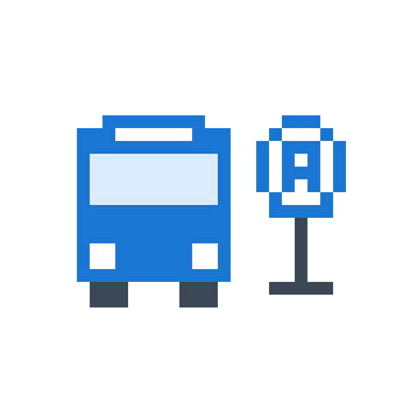

# 감고당의 구황작물 Factory

##  버승버승
실시간 버스 도착 정보를 다이나믹 아일랜드에 띄워주는 iOS APP   
잠금화면, 다이나믹 아일랜드, 알림 설정 지원

- **Stack**:  
- **Link**: 

##  Homebridge 홈서버
라즈베리파이 + Docker를 이용한 Homebridge 구축, Apple HomeKit 비지원 기기를 애플 홈에 연동  
Pico 2W를 통한 IoT 기기 제작 및 연동

- **Stack**:     
- **device**:   
